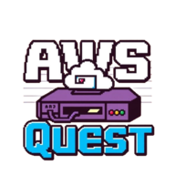

# AWS Lab Quest

<div align="center">



**Plataforma de preparação para certificações AWS com gamificação, modos de estudo adaptativos e pipeline de conteúdo com IA.**

[](https://nextjs.org)
[](https://typescriptlang.org)
[](https://prisma.io)
[](https://bullmq.io)
[](LICENSE)

</div>

---

## Sumário

- [Visão geral](#visão-geral)
- [Principais diferenciais](#principais-diferenciais)
- [Modos de estudo](#modos-de-estudo)
- [Arquitetura](#arquitetura)
- [Ciclo de conteúdo autoalimentado](#ciclo-de-conteúdo-autoalimentado)
- [Stack](#stack)
- [Pré-requisitos](#pré-requisitos)
- [Configuração local](#configuração-local)
- [Variáveis de ambiente](#variáveis-de-ambiente)
- [Autenticação e controle de acesso](#autenticação-e-controle-de-acesso)
- [Testes](#testes)
- [Deploy com Docker](#deploy-com-docker)
- [Estrutura do projeto](#estrutura-do-projeto)
- [Fluxos principais](#fluxos-principais)
- [Documentação técnica](#documentação-técnica)
- [Contribuindo](#contribuindo)
- [Licença](#licença)

---

## Visão geral

O **AWS Lab Quest** é uma aplicação web em português para preparação de certificações AWS. A experiência combina prática contínua de questões com elementos de RPG: o aluno ganha XP, sobe de nível, desbloqueia conquistas e evolui com base no próprio desempenho.

A plataforma atende diferentes ritmos de estudo, de revisões rápidas a simulados completos, com geração e manutenção contínua de conteúdo por IA.

---

## Principais diferenciais

- **Gamificação completa**: XP por dificuldade (`XpWeightConfig`), níveis, badges e 12 conquistas automáticas.
- **Pipeline de questões com IA**: ingestão de materiais (Exam Guides e PDFs), deduplicação por `usageHash`, avaliação e regeneração contínua.
- **Mentor IA (determinístico)**: recomendações priorizadas por histórico, sem chamadas de IA em tempo real.
- **Biblioteca contextual**: materiais complementares (PDF, imagem, markdown e slides) sugeridos por tema e lacunas.
- **Leaderboard em tempo real**: ranking atualizado via Supabase Realtime.
- **Progressão em modos especializados**: Arena (boss battles), Trilhas (jornadas guiadas) e Simulado (prova formal com revisão).

---

## Modos de estudo

Os três modos-base seguem uma progressão de formalidade. Arena e Trilhas reaproveitam a mesma mecânica de pergunta/revelação do Simulado.

| Modo | Descrição |
|---|---|
| **Lab** | Quests temáticas geradas por IA com contexto personalizado (ex.: música, games, esporte). |
| **KC (Knowledge Check)** | Bateria de questões por serviço/tópico para revisão pontual. |
| **Simulado** | Prova completa com timer, marcação de questões, revisão pré-envio e score final. |
| **Arena** | Batalhas contra bosses temáticos: cada acerto causa dano no boss. |
| **Trilhas** | Trilhas guiadas por tópico, com estágios e progressão por desbloqueio. |

---

## Arquitetura

```text
┌─────────────────────────────────┐     ┌──────────────────────┐
│          awlq-app               │     │     awlq-worker      │
│        (Next.js 16)             │     │  (BullMQ + Node.js)  │
│                                 │     │                      │
│  App Router ─ API Routes        │     │  source-fetch        │
│  Zustand ─ Framer Motion        │     │  question-generation │
│  Better Auth ─ Prisma           │     │  feedback-analysis   │
│  Supabase Realtime              │◄────│  performance-compute │
│                                 │     │  quality-review      │
└────────────┬────────────────────┘     │  email-send          │
             │                          └──────────┬───────────┘
             ▼                                     ▼
      ┌──────────────┐               ┌─────────────────────────┐
      │  PostgreSQL  │               │  Redis (BullMQ queues)  │
      └──────────────┘               └─────────────────────────┘
             │
      ┌──────┴──────┐
      │  Supabase   │  ← Storage (avatars, badges) + Realtime
      └─────────────┘
```

- **`awlq-app`**: frontend, páginas, rotas de API e autenticação (operações síncronas).
- **`awlq-worker`**: processamento em background (operações assíncronas e mais custosas).
- **Banco compartilhado**: ambos usam o mesmo schema Prisma em `packages/db/prisma/schema.prisma`.
- **Acionamento do worker**:
  - via tabela `WorkerTrigger` (poll a cada 30s por `trigger-poller.ts`);
  - via push direto em filas BullMQ.

---

## Ciclo de conteúdo autoalimentado

Mecanismo central do produto para manter o banco de questões atualizado e calibrado.

```text
StudySessionHistory (respostas do usuário)
  → feedback-analysis.worker    (marca áreas fracas, correctRate < 60%)
  → question-generation.worker  (prompt Gemini ponderado por ExamBlueprintDomain)
  → performance-compute.worker  (correctRate, índice de discriminação)
  → quality-review.worker       (IA aposenta ou reescreve questões de baixa qualidade)
  → de volta ao pool de estudo

source-fetch.worker (em paralelo): baixa Exam Guides da AWS → extrai domínios do blueprint
```

Cada worker possui concorrência limitada (`concurrency: 1` para jobs que usam IA). Jobs são idempotentes quando possível; colisão de `usageHash` é o único caso aceitável de no-op silencioso.

---

## Stack

### awlq-app (Frontend + API)

| Camada | Tecnologia |
|---|---|
| Framework | Next.js 16 (App Router) + React 19 |
| Linguagem | TypeScript 5 |
| Estilo | Tailwind CSS 4 + Radix UI |
| Auth | Better Auth 1.5 (email/senha, sessões) |
| ORM | Prisma 7 + PostgreSQL |
| Storage & Realtime | Supabase |
| AI | Google Gemini API (`@google/generative-ai`) |
| Estado | Zustand 5 |
| Animações | Framer Motion 12 |
| Email | Resend (HTTP API) |

### awlq-worker (Background Jobs)

| Camada | Tecnologia |
|---|---|
| Filas | BullMQ 5 + IORedis |
| ORM | Prisma 7 (DB compartilhado) |
| AI | Google Gemini API |
| Logs | Pino 9 |
| Runtime | Node.js 22 / Bun |

---

## Pré-requisitos

- Node.js 22+ (ou Bun)
- Docker + Docker Compose
- Conta Google Cloud com Gemini API habilitada
- Projeto Supabase (Storage + Realtime)
- Domínio de envio verificado no Resend

---

## Configuração local

### 1) Clonar o repositório e instalar dependências

```bash
git clone https://github.com/wallacemt/aws-lab-quest.git
cd aws-lab-quest

# App
cd awlq-app && npm install

# Worker
cd ../awlq-worker && npm install
cd ..
```

### 2) Configurar variáveis de ambiente

```bash
cp .env.example awlq-app/.env
cp .env.example awlq-worker/.env
```

Edite os arquivos `.env` com base na seção [Variáveis de ambiente](#variáveis-de-ambiente).

### 3) Subir infraestrutura local

```bash
docker compose up -d postgres redis
```

> O `docker-compose.yml` da raiz orquestra todos os serviços. Para desenvolvimento local, suba apenas `postgres` e `redis` e execute app/worker fora do Docker.

### 4) Preparar banco de dados

```bash
cd awlq-app
npm run db:generate
npm run db:migrate
npm run db:seed
```

> Após qualquer alteração de schema, execute `npm run prisma:generate` também em `awlq-worker/`, que usa o mesmo `schema.prisma` com client gerado próprio.

### 5) Iniciar aplicação

Em terminais separados:

```bash
# Terminal 1 — App Next.js
cd awlq-app && npm run dev

# Terminal 2 — Worker BullMQ
cd awlq-worker && npm run dev
```

Acesse: **http://localhost:3000**

---

## Variáveis de ambiente

Crie os arquivos `.env` a partir de [`.env.example`](.env.example).

### Obrigatórias

| Variável | Descrição |
|---|---|
| `DATABASE_URL` | URL de conexão PostgreSQL |
| `REDIS_URL` | URL do Redis (ex.: `redis://localhost:6379`) |
| `BETTER_AUTH_SECRET` | String aleatória com pelo menos 32 caracteres |
| `BETTER_AUTH_URL` | URL base da aplicação |
| `GEMINI_API_KEY` | Chave da Google Generative AI |
| `SUPABASE_URL` | URL do projeto Supabase |
| `SUPABASE_SERVICE_ROLE_KEY` | Service role JWT do Supabase |
| `SUPABASE_ANON_KEY` | Anon key do Supabase |
| `RESEND_API_KEY` | Chave da API do Resend (somente servidor) |
| `RESEND_FROM_EMAIL` | Endereço remetente verificado no Resend |

### Opcionais

| Variável | Padrão | Descrição |
|---|---|---|
| `GEMINI_MODEL` | `gemini-2.5-flash` | Modelo Gemini para geração |
| `POLLINATIONS_API_KEY` | — | Chave para geração de imagens de badges |
| `ADMIN_EMAIL` | — | Email do admin inicial (seed) |
| `ADMIN_PASSWORD` | — | Senha do admin inicial (seed) |
| `WEAK_AREA_THRESHOLD` | `0.60` | Taxa mínima de acerto para área fraca |
| `TRIGGER_POLL_INTERVAL_MS` | `30000` | Intervalo do poller de triggers (ms) |
| `LOG_LEVEL` | `info` | Nível de log do worker |

---

## Autenticação e controle de acesso

A autenticação usa Better Auth 1.5 (email/senha), com configuração em `lib/auth.ts` e helpers de cliente em `lib/auth-client.ts`.

- Novos usuários entram como `accessStatus: pending`.
- A aprovação acontece em `/admin/users` (ou via `SystemConfig.auto_approve_users`).
- Rotas `api/admin/*` usam `requireAdmin(request)` e validam sessão **e** `role === "admin"`.

---

## Testes

Vitest (`environment: "node"`, globals habilitado), com um `vitest.config.ts` por pacote.

```bash
# awlq-app
cd awlq-app
npm run test
npx vitest run src/__tests__/arena.test.ts
npx vitest run -t "nome do teste"

# awlq-worker
cd awlq-worker
npm run test
```

Antes de abrir PR, o mínimo exigido em [CONTRIBUTING.md](CONTRIBUTING.md):

```bash
# awlq-app
npm run lint
npx tsc --noEmit
npx next build

# awlq-worker
npx tsc --noEmit
```

---

## Deploy com Docker

Para subir toda a stack em modo próximo de produção:

```bash
# Uma vez
docker network create rt-network

# Build + start
docker compose up -d --build
```

Serviços principais:
- `rt-awslq-app` (porta 3000)
- `rt-awslq-worker` (rede `rt-network`)

Comandos úteis:

```bash
docker compose logs -f
docker compose down
docker compose restart worker
```

---

## Estrutura do projeto

```text
aws-lab-quest/
├── awlq-app/               # Next.js app (frontend + API)
│   └── src/
│       ├── app/            # App Router: páginas e API routes
│       ├── components/     # Componentes reutilizáveis (ui/, layout/)
│       ├── features/       # Domínios com components/hooks/screens/services
│       ├── hooks/          # Custom hooks React
│       ├── lib/            # Singletons: auth, prisma, ai, storage, redis, levels, achievements
│       └── stores/         # Zustand stores
│
├── awlq-worker/            # Worker BullMQ (background)
│   └── src/
│       ├── workers/        # Processadores por fila (source-fetch, question-generation, ...)
│       ├── services/       # Lógica de negócio desacoplada da fila
│       ├── shared/         # Compartilhado com o app (buildUsageHash, validateQuestion, persistQuestion)
│       ├── cron/           # Jobs recorrentes (ScheduledJob)
│       └── queues/         # Filas BullMQ + tipos de payload
│
├── packages/db/prisma/     # Schema Prisma, migrations e client compartilhado
├── docs/                   # Documentação técnica complementar
├── docker-compose.yml
└── .env.example
```

Convenção no app: `src/app/` permanece fino (roteamento + data fetch no servidor) e a lógica de domínio fica em `src/features/<domínio>/`.

---

## Fluxos principais

### Exam Guide e Simulado

1. Admin envia o guia oficial em **`/admin/upload`** (tipo: Exam Guide).
2. O sistema extrai blueprint de domínios e pesos automaticamente.
3. Sem Exam Guide, o endpoint de questões retorna erro de bloqueio.
4. Admin envia PDF de simulado para ingestão de questões.

### Pipeline de questões via IA

```text
PDF/Markdown → Extração → Segmentação de blocos → Gemini API
→ Validação (schema, mínimo de opções) → Deduplicação (usageHash)
→ Persistência no banco
```

O worker também gera variantes mais difíceis de questões já respondidas para reduzir repetição em simulados futuros.

### Conquistas

As conquistas são desbloqueadas automaticamente ao salvar histórico de Lab/KC/Simulado.
A galeria em `/achievements` mostra progresso, status de unlock e link público de compartilhamento.

---

## Documentação técnica

| Documento | Descrição |
|---|---|
| [achievements-system.md](docs/achievements-system.md) | Sistema de conquistas e desbloqueio |
| [simulado-pdf-pipeline.md](docs/tech/simulado-pdf-pipeline.md) | Pipeline PDF → Questão |
| [platform-upgrade-2026-03.md](docs/platform-upgrade-2026-03.md) | Arquitetura e melhorias recentes |
| [question-ingestion-refactor-2026-03.md](docs/tech/question-ingestion-refactor-2026-03.md) | Refactor do worker de ingestão |
| [create-lab-quest-v1.md](docs/showcase/labs/create-lab-quest-v1.md) | Como criar um Lab Quest |
| [CONTRIBUTING.md](CONTRIBUTING.md) | Como contribuir com o projeto |

---

## Contribuindo

Contribuições são bem-vindas. Consulte o [guia de contribuição](CONTRIBUTING.md) para reportar bugs, sugerir melhorias e enviar pull requests.

---

## Licença

MIT © [AWS Lab Quest Contributors](LICENSE)
